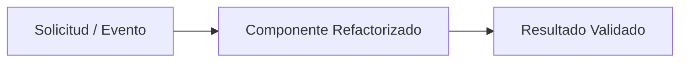
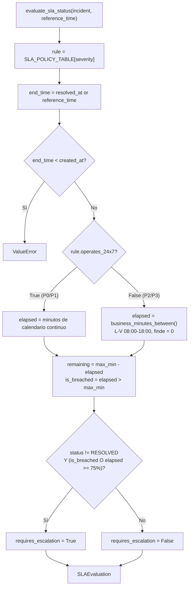
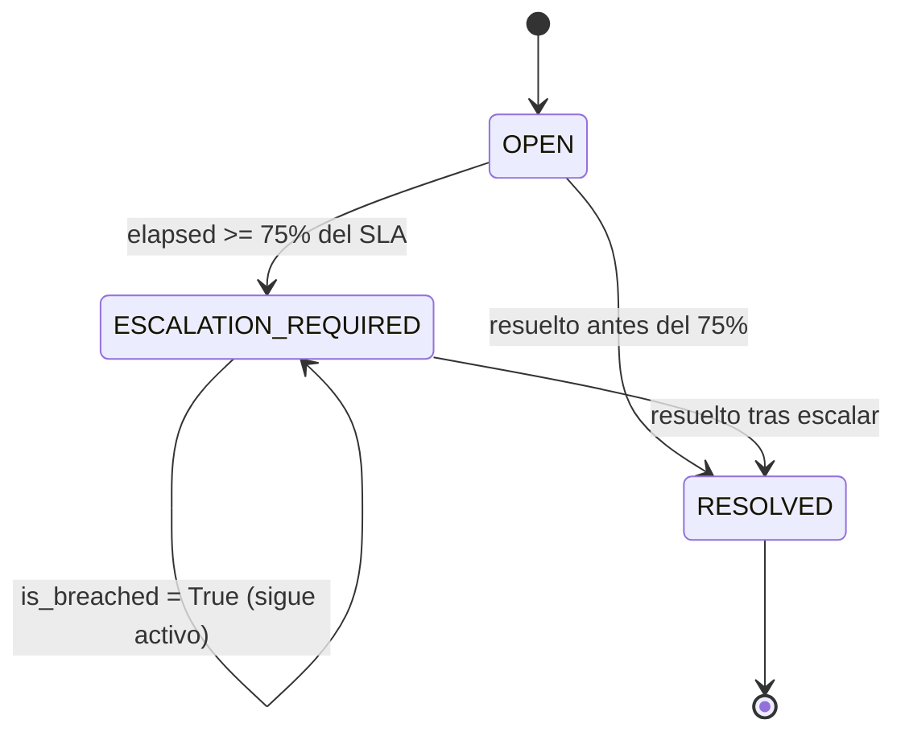

# Bitácora de Ingeniería de Prompts y Contexto — Semana 1 (`CONTEXT_LOG.md`)

**Estudiante(s)**: `Laura Nataly Cetina Siqueira`

**Fecha**: `2026-11-10`

**Modelos / Asistentes Utilizados**: `ChatGPT (GPT-5 modo estándar y modo razonamiento/thinking)`

---

## 1. De Prompts Pobres a Técnicas Clásicas de *Prompt Engineering* (Reto 1: `src/triage_rules.py`)

### 1.1 Diagnóstico de un Prompt Pobre y Ambiguo

> *"El archivo `triage_rules.py` funciona mal con algunos tickets del JSON. Agrégale el equipo recomendado y una clave para duplicados, y no pongas P0 cuando no sea urgente."*

Fallos estructurales detectados:

1. **Valores válidos sin enumerar (ambigüedad de dominio).** Pide "el equipo recomendado" pero
   nunca dice que solo existen 4 equipos válidos (`Backend-Core`, `Platform-SRE`, `Data-DBA`,
   `Security-IAM`), ni qué formato debe tener la "clave para duplicados". El modelo inventaría
   nombres y formatos arbitrarios.
2. **Restricción negativa difusa.** "No pongas P0 cuando no sea urgente" define el objetivo por
   negación y con un término subjetivo ("urgente"). No dice qué SÍ es P0 (caída global) frente
   a P3 (caso individual), que es justo el bug de la palabra "hoy".
3. **Ausencia de contexto/justificación de dominio.** No explica el *porqué* de cada severidad
   ni el impacto real (indisponibilidad global vs. una cuenta vs. fuga de datos entre empresas),
   así que el modelo no puede corregir INC-1007 ni INC-1002.
4. **Falta de ejemplos canónicos (Few-Shot).** No muestra ningún caso resuelto ni cómo se ven
   dos incidentes duplicados (INC-1001/INC-1006), por lo que el criterio de agrupación queda al azar.

### 1.2 Uso de *Self-Consistency*, *Chain-of-Thought* y *Few-Shot Prompting*

**Cómo se aplicó.** Primero extraje el contexto mínimo con LSP:

```bash
uv run python -m src.context_audit --symbol classify_incident_report
```

Luego abrí **3 chats nuevos independientes** con el mismo prompt de exploración (Prompt B,
Chain-of-Thought dentro de `<analysis>`) y comparé las tres tablas (Self-Consistency). Los tres
coincidieron en 8 de 10 incidentes; las discrepancias fueron:
- **INC-1007**: dos corridas dieron P1 y una P0. Se eligió **P1** (fuga de datos grave pero no
  es indisponibilidad total del servicio) por mayoría y por justificación de dominio.
- **INC-1009**: una corrida dio P3 y dos P2. Se eligió **P2** (degradación de rendimiento que
  sí completa la descarga) por mayoría.

**Prompt B — Exploración (Chain-of-Thought + Self-Consistency), sin código:**

```xml
<role>
Eres un Senior SRE y líder de triaje de incidentes en IncidentOps.
</role>
<context>
Estoy auditando el motor de triaje antes de refactorizarlo. TODAVÍA NO quiero código.
Definición actual (extraída con LSP):
<lsp_context symbol="classify_incident_report">
  <!-- 1. Definiciones de Tipos y Políticas (LSP Hover / Type Definition) -->
# [LSP textDocument/hover type] src\models.py:12
class SLARule:
    """Define el acuerdo de nivel de servicio (SLA) para un nivel de severidad."""

    severity: SeverityLevel
    max_resolution_minutes: int
    operates_24x7: bool
    escalation_threshold_ratio: float = 0.75

# [LSP textDocument/hover type] src\models.py:22
class Incident:
    """Representa un incidente registrado en la plataforma IncidentOps."""

    incident_id: str
    title: str
    component: str
    severity: SeverityLevel
    status: IncidentStatus
    created_at: datetime
    resolved_at: Optional[datetime] = None

# [LSP textDocument/hover type] src\models.py:35
class SLAEvaluation:
    """Resultado determinista de la evaluación de SLA de un incidente."""

    incident_id: str
    severity: SeverityLevel
    elapsed_minutes: int
    allowed_minutes: int
    remaining_minutes: int
    is_breached: bool
    requires_escalation: bool

# [LSP textDocument/hover type] src\models.py:48
class TriageResult:
    """Resultado estructurado producido por el clasificador de triaje con IA."""

    incident_id: str
    severity: SeverityLevel
    component: str
    rationale: str
    consistency_ratio: float = 1.0

# [LSP textDocument/hover symbol] src\sla_calculator.py:17
SLA_POLICY_TABLE: Dict[SeverityLevel, SLARule] = {
    "P0": SLARule(severity="P0", max_resolution_minutes=60, operates_24x7=True),
    "P1": SLARule(severity="P1", max_resolution_minutes=240, operates_24x7=True),
    "P2": SLARule(severity="P2", max_resolution_minutes=480, operates_24x7=False),
    "P3": SLARule(severity="P3", max_resolution_minutes=1440, operates_24x7=False),
}

  <!-- 2. Definición Exacta del Símbolo (LSP GoToDefinition) -->
# [LSP textDocument/definition] src\triage_rules.py:27
def classify_incident_report(incident_id: str, raw_text: str) -> TriageResult:
    """Clasifica un reporte de incidente aplicando reglas heurísticas iniciales.

    DEUDA TÉCNICA INTENCIONAL:
    - Evalúa palabras sueltas ("hoy", "urgente") antes de analizar el impacto real
      (caída global vs. cuenta individual vs. entorno de staging).
    - No normaliza componentes ni identifica el equipo de guardia correspondiente.
    """
    text_lower = raw_text.lower()

    # Bug de diseño: si un usuario dice "necesito acceder hoy" por su cuenta bloqueada,
    # se dispara como P0 antes de verificar si es una caída global o un caso individual.
    if "urgente" in text_lower or "hoy" in text_lower or "502" in text_lower:
        severity: SeverityLevel = "P0"
    elif "94%" in text_lower or "timeout" in text_lower:
        severity = "P1"
    elif "lenta" in text_lower or "segundos" in text_lower:
        severity = "P2"
    else:
        severity = "P3"

    if "pago" in text_lower or "cobro" in text_lower or "tarjeta" in text_lower:
        component = "payments-gateway"
    elif "cuenta" in text_lower or "ingresar" in text_lower:
        component = "auth-identity"
    elif "postgresql" in text_lower or "conexiones" in text_lower:
        component = "database-cluster"
    elif "certificado" in text_lower or "tls" in text_lower:
        component = "infra-certificates"
    elif "botón" in text_lower or "color" in text_lower:
        component = "frontend-ui"
    else:
        component = "reporting-api"

    return TriageResult(
        incident_id=incident_id,
        severity=severity,
        component=component,
        rationale=f"Clasificación heurística legacy asignada a {component} ({severity}).",
    )

  <!-- 3. Referencias de Invocación en el Proyecto (LSP FindReferences) -->
# [LSP textDocument/references] src\triage_rules.py:77
  L76:     for item in incidents:
  L77:         result = classify_incident_report(item["id"], item["raw_text"])
  L78:         snippet = item["raw_text"][:45] + "..." if len(item["raw_text"]) > 45 else item["raw_text"]
</lsp_context>
</context>
<domain_rules>
P0: caída/indisponibilidad GLOBAL de un servicio crítico.
P1: degradación grave o riesgo de seguridad con impacto amplio.
P2: degradación de rendimiento perceptible pero el sistema funciona.
P3: impacto individual, cosmético o preventivo.
Equipos válidos (solo estos 4): Backend-Core, Platform-SRE, Data-DBA, Security-IAM.
Clave de duplicados: "<component>:<symptom_category>".
</domain_rules>
<task>
Razona PASO A PASO dentro de <analysis> para cada uno de los 10 incidentes y determina
severity, component, recommended_team y duplicate_group_key basándote en el IMPACTO REAL,
no en palabras sueltas ("hoy", "urgente"). Justifica los casos ambiguos INC-1002, INC-1007,
INC-1009 y los pares de duplicados INC-1001/INC-1006 e INC-1003/INC-1008. Al final entrega
una tabla resumen y la lista de grupos de duplicados.
</task>
<incidents>
[
  {
    "id": "INC-1001",
    "reporter": "carlos.mendoza@clientes-corp.com",
    "created_at": "2026-11-05T08:15:00",
    "raw_text": "URGENTE: El gateway de pagos devuelve HTTP 502 Bad Gateway en todas las transacciones con tarjeta de crédito desde hace 12 minutos. Ningún comercio puede cobrar."
  },
  {
    "id": "INC-1002",
    "reporter": "ana.gomez@clientes-corp.com",
    "created_at": "2026-11-05T09:10:00",
    "raw_text": "He intentado ingresar a mi cuenta tres veces y ahora aparece bloqueada. Necesito acceder hoy mismo porque debo enviar el informe de cierre a la junta directiva."
  },
  {
    "id": "INC-1003",
    "reporter": "soporte-nivel1@incidentops.internal",
    "created_at": "2026-11-05T10:05:00",
    "raw_text": "El dashboard de reportes históricos tarda cerca de 4.5 segundos en cargar cuando un cliente tiene más de 10,000 órdenes registradas. No da error, pero la experiencia es muy lenta."
  },
  {
    "id": "INC-1004",
    "reporter": "luis.torres@logistica-express.co",
    "created_at": "2026-11-05T11:20:00",
    "raw_text": "Sería excelente si pudieran cambiar el color del botón de exportar CSV a verde oscuro porque el gris actual casi no resalta en mi monitor secundario."
  },
  {
    "id": "INC-1005",
    "reporter": "alertas-monitoreo@incidentops.internal",
    "created_at": "2026-11-05T11:45:00",
    "raw_text": "El nodo primario de PostgreSQL muestra un uso de conexiones del 94% y timeouts intermitentes en el pool de conexiones del servicio de facturación."
  },
  {
    "id": "INC-1006",
    "reporter": "maria.rodriguez@retail-latam.com",
    "created_at": "2026-11-05T13:00:00",
    "raw_text": "Otra vez cayó la pasarela de cobros con tarjeta, a nuestros clientes les sale error 502 al intentar pagar el carrito de compras."
  },
  {
    "id": "INC-1007",
    "reporter": "auditoria@seguridad-fin.com",
    "created_at": "2026-11-05T14:30:00",
    "raw_text": "Detectamos que al cambiar el parámetro company_id en la URL del reporte PDF se pueden visualizar facturas pertenecientes a otra organización."
  },
  {
    "id": "INC-1008",
    "reporter": "pedro.sanchez@ventas-norte.com",
    "created_at": "2026-11-05T15:10:00",
    "raw_text": "El listado de planes e historial tarda más de 3 segundos en responder cada vez que abrimos la pestaña de clientes corporativos con más de 10,000 registros."
  },
  {
    "id": "INC-1009",
    "reporter": "elena.vargas@contabilidad-global.com",
    "created_at": "2026-11-05T16:40:00",
    "raw_text": "La exportación mensual a Excel se queda pensando unos 20 segundos pero al final sí descarga el archivo completo. Hoy tenemos cierre contable y nos preocupa que falle más tarde."
  },
  {
    "id": "INC-1010",
    "reporter": "devops-ci@incidentops.internal",
    "created_at": "2026-11-05T17:25:00",
    "raw_text": "El certificado TLS del entorno de staging vencerá en 14 días. Requiere rotación programada antes del próximo sprint."
  }
]
</incidents>
```

**Prompt C — Refactorización (Role + Instrucciones afirmativas + Few-Shot + XML):**

```xml
<role>
Eres un ingeniero de software senior en Python. Escribes código determinista, tipado y legible.
</role>
<context>
<lsp_context symbol="classify_incident_report">
  <!-- 1. Definiciones de Tipos y Políticas (LSP Hover / Type Definition) -->
# [LSP textDocument/hover type] src\models.py:12
class SLARule:
    """Define el acuerdo de nivel de servicio (SLA) para un nivel de severidad."""

    severity: SeverityLevel
    max_resolution_minutes: int
    operates_24x7: bool
    escalation_threshold_ratio: float = 0.75

# [LSP textDocument/hover type] src\models.py:22
class Incident:
    """Representa un incidente registrado en la plataforma IncidentOps."""

    incident_id: str
    title: str
    component: str
    severity: SeverityLevel
    status: IncidentStatus
    created_at: datetime
    resolved_at: Optional[datetime] = None

# [LSP textDocument/hover type] src\models.py:35
class SLAEvaluation:
    """Resultado determinista de la evaluación de SLA de un incidente."""

    incident_id: str
    severity: SeverityLevel
    elapsed_minutes: int
    allowed_minutes: int
    remaining_minutes: int
    is_breached: bool
    requires_escalation: bool

# [LSP textDocument/hover type] src\models.py:48
class TriageResult:
    """Resultado estructurado producido por el clasificador de triaje con IA."""

    incident_id: str
    severity: SeverityLevel
    component: str
    rationale: str
    consistency_ratio: float = 1.0

# [LSP textDocument/hover symbol] src\sla_calculator.py:17
SLA_POLICY_TABLE: Dict[SeverityLevel, SLARule] = {
    "P0": SLARule(severity="P0", max_resolution_minutes=60, operates_24x7=True),
    "P1": SLARule(severity="P1", max_resolution_minutes=240, operates_24x7=True),
    "P2": SLARule(severity="P2", max_resolution_minutes=480, operates_24x7=False),
    "P3": SLARule(severity="P3", max_resolution_minutes=1440, operates_24x7=False),
}

  <!-- 2. Definición Exacta del Símbolo (LSP GoToDefinition) -->
# [LSP textDocument/definition] src\triage_rules.py:27
def classify_incident_report(incident_id: str, raw_text: str) -> TriageResult:
    """Clasifica un reporte de incidente aplicando reglas heurísticas iniciales.

    DEUDA TÉCNICA INTENCIONAL:
    - Evalúa palabras sueltas ("hoy", "urgente") antes de analizar el impacto real
      (caída global vs. cuenta individual vs. entorno de staging).
    - No normaliza componentes ni identifica el equipo de guardia correspondiente.
    """
    text_lower = raw_text.lower()

    # Bug de diseño: si un usuario dice "necesito acceder hoy" por su cuenta bloqueada,
    # se dispara como P0 antes de verificar si es una caída global o un caso individual.
    if "urgente" in text_lower or "hoy" in text_lower or "502" in text_lower:
        severity: SeverityLevel = "P0"
    elif "94%" in text_lower or "timeout" in text_lower:
        severity = "P1"
    elif "lenta" in text_lower or "segundos" in text_lower:
        severity = "P2"
    else:
        severity = "P3"

    if "pago" in text_lower or "cobro" in text_lower or "tarjeta" in text_lower:
        component = "payments-gateway"
    elif "cuenta" in text_lower or "ingresar" in text_lower:
        component = "auth-identity"
    elif "postgresql" in text_lower or "conexiones" in text_lower:
        component = "database-cluster"
    elif "certificado" in text_lower or "tls" in text_lower:
        component = "infra-certificates"
    elif "botón" in text_lower or "color" in text_lower:
        component = "frontend-ui"
    else:
        component = "reporting-api"

    return TriageResult(
        incident_id=incident_id,
        severity=severity,
        component=component,
        rationale=f"Clasificación heurística legacy asignada a {component} ({severity}).",
    )

  <!-- 3. Referencias de Invocación en el Proyecto (LSP FindReferences) -->
# [LSP textDocument/references] src\triage_rules.py:77
  L76:     for item in incidents:
  L77:         result = classify_incident_report(item["id"], item["raw_text"])
  L78:         snippet = item["raw_text"][:45] + "..." if len(item["raw_text"]) > 45 else item["raw_text"]
</lsp_context>
</context>
<domain_rules>
- Severidad por impacto real (P0 global, P1 grave/seguridad, P2 degradación, P3 individual).
- 4 equipos válidos: Backend-Core, Platform-SRE, Data-DBA, Security-IAM.
- recommended_team se deriva del componente.
- duplicate_group_key = "<component>:<symptom_category>" normalizada.
</domain_rules>
<examples>
<example>
Entrada: INC-1001 "El gateway de pagos devuelve HTTP 502 en todas las transacciones..."
Salida: severity=P0, component=payments-gateway, recommended_team=Backend-Core,
        duplicate_group_key=payments-gateway:http-502
</example>
<example>
Entrada: INC-1006 "Otra vez cayó la pasarela de cobros, sale error 502 al pagar..."
Salida: severity=P0, component=payments-gateway, recommended_team=Backend-Core,
        duplicate_group_key=payments-gateway:http-502  (DUPLICADO de INC-1001)
</example>
</examples>
<task>
Refactoriza src/models.py (añade TeamName y los campos recommended_team y duplicate_group_key
en TriageResult) y src/triage_rules.py para que classify_incident_report clasifique por impacto,
asigne el equipo y genere la clave de duplicados. Mantén el bloque __main__ mostrando los 10
incidentes y los grupos de duplicados. Entrega los dos archivos completos.
</task>
```

**Resultado verificado** con `uv run python -m src.triage_rules`:

| id | severity | component | recommended_team | duplicate_group_key |
| :-- | :-- | :-- | :-- | :-- |
| INC-1001 | P0 | payments-gateway | Backend-Core | payments-gateway:http-502 |
| INC-1002 | P3 | auth-identity | Security-IAM | auth-identity:account-locked |
| INC-1003 | P2 | reporting-api | Data-DBA | reporting-api:latency-high |
| INC-1004 | P3 | frontend-ui | Backend-Core | frontend-ui:ui-cosmetic |
| INC-1005 | P1 | database-cluster | Data-DBA | database-cluster:resource-saturation |
| INC-1006 | P0 | payments-gateway | Backend-Core | payments-gateway:http-502 |
| INC-1007 | P1 | security-authz | Security-IAM | security-authz:idor-cross-tenant |
| INC-1008 | P2 | reporting-api | Data-DBA | reporting-api:latency-high |
| INC-1009 | P2 | reporting-api | Data-DBA | reporting-api:latency-high |
| INC-1010 | P3 | infra-certificates | Platform-SRE | infra-certificates:cert-expiry |

Duplicados detectados: `payments-gateway:http-502` → INC-1001, INC-1006 ·
`reporting-api:latency-high` → INC-1003, INC-1008 (y también INC-1009).
Los bugs del prompt pobre quedan corregidos: INC-1002 y INC-1009 ya **no** son P0, e INC-1007
sube de P3 a P1 de seguridad.

---

## 2. Flujo Explorar → Destilar → Ejecutar en Contexto Limpio (Reto 2: SLA Horario Hábil y ADR-002)

### 2.1 Exploración de Diseño (Sin Generar Código Aún) y Destilación

- **Objetivo explorado**: cálculo de SLA en horario hábil (P2/P3, L–V 08:00–18:00) vs. 24/7
  (P0/P1) y escalamiento preventivo al 75%.
- **Síntesis de la exploración y resumen destilado (≤10 líneas)** que llevé al chat limpio:

  > 1. P0/P1 corren 24/7; P2/P3 solo cuentan L–V 08:00–18:00 (máx. 600 min/día).
  > 2. Un viernes 18:30 está fuera de ventana: no suma hasta el lunes 08:00.
  > 3. Creación en sábado/domingo: 0 minutos hasta el lunes.
  > 4. Cruces de varios fines de semana: iterar día por día e intersectar con la ventana.
  > 5. Descartada librería externa (rompe cero dependencias) y la iteración minuto a minuto (O(N) lento).
  > 6. Elegido algoritmo O(D) día por día, solo `datetime`.
  > 7. Escalamiento: no apagarlo tras el breach; `requires_escalation = status!=RESOLVED and (is_breached or elapsed>=75%)`.
  > 8. Verificación: 5+ casos borde deterministas en `__main__`.

**Prompt D — Exploración de casos borde (Chat 1, sin código):**

```xml
<context>
<lsp_context symbol="evaluate_sla_status">
  <!-- 1. Definiciones de Tipos y Políticas (LSP Hover / Type Definition) -->
# [LSP textDocument/hover type] src\models.py:13
class SLARule:
    """Define el acuerdo de nivel de servicio (SLA) para un nivel de severidad."""

    severity: SeverityLevel
    max_resolution_minutes: int
    operates_24x7: bool
    escalation_threshold_ratio: float = 0.75

# [LSP textDocument/hover type] src\models.py:23
class Incident:
    """Representa un incidente registrado en la plataforma IncidentOps."""

    incident_id: str
    title: str
    component: str
    severity: SeverityLevel
    status: IncidentStatus
    created_at: datetime
    resolved_at: Optional[datetime] = None

# [LSP textDocument/hover type] src\models.py:36
class SLAEvaluation:
    """Resultado determinista de la evaluación de SLA de un incidente."""

    incident_id: str
    severity: SeverityLevel
    elapsed_minutes: int
    allowed_minutes: int
    remaining_minutes: int
    is_breached: bool
    requires_escalation: bool

# [LSP textDocument/hover type] src\models.py:49
class TriageResult:
    """Resultado estructurado producido por el clasificador de triaje con IA.

    Campos añadidos en la refactorización de la Semana 1 (Reto 1):
    - recommended_team: equipo de guardia responsable, restringido a 4 valores válidos.
    - duplicate_group_key: clave normalizada `<component>:<symptom_category>` para
      detectar incidentes duplicados del mismo problema subyacente.
    """

    incident_id: str
    severity: SeverityLevel
    component: str
    rationale: str
    recommended_team: Optional[TeamName] = None
    duplicate_group_key: Optional[str] = None
    consistency_ratio: float = 1.0

# [LSP textDocument/hover symbol] src\sla_calculator.py:24
SLA_POLICY_TABLE: Dict[SeverityLevel, SLARule] = {
    "P0": SLARule(severity="P0", max_resolution_minutes=60, operates_24x7=True),
    "P1": SLARule(severity="P1", max_resolution_minutes=240, operates_24x7=True),
    "P2": SLARule(severity="P2", max_resolution_minutes=480, operates_24x7=False),
    "P3": SLARule(severity="P3", max_resolution_minutes=1440, operates_24x7=False),
}

  <!-- 2. Definición Exacta del Símbolo (LSP GoToDefinition) -->
# [LSP textDocument/definition] src\sla_calculator.py:32
def get_sla_rule_for_severity(severity: SeverityLevel) -> SLARule:
    """Obtiene la regla de SLA aplicable a una severidad validada contra la tabla."""
    if severity not in SLA_POLICY_TABLE:
        raise ValueError(f"Severidad no válida: {severity}")
    return SLA_POLICY_TABLE[severity]

# [LSP textDocument/definition] src\sla_calculator.py:72
def evaluate_sla_status(incident: Incident, reference_time: datetime) -> SLAEvaluation:
    """Evalúa si un incidente ha incumplido su SLA o requiere escalamiento preventivo.

    Usa tiempo 24/7 para severidades con `operates_24x7=True` (P0/P1) y solo horario
    hábil para las de `operates_24x7=False` (P2/P3).

    Args:
        incident: Entidad del incidente a evaluar.
        reference_time: Marca de tiempo actual o de cierre contra la cual medir.

    Returns:
        SLAEvaluation con los minutos transcurridos, restantes y banderas de estado.
    """
    rule = get_sla_rule_for_severity(incident.severity)
    end_time = incident.resolved_at or reference_time

    if end_time < incident.created_at:
        raise ValueError("El tiempo de referencia no puede ser anterior a la creación.")

    if rule.operates_24x7:
        elapsed_minutes = _continuous_minutes_between(incident.created_at, end_time)
    else:
        elapsed_minutes = business_minutes_between(incident.created_at, end_time)

    remaining_minutes = rule.max_resolution_minutes - elapsed_minutes
    is_breached = elapsed_minutes > rule.max_resolution_minutes

    escalation_limit = int(rule.max_resolution_minutes * rule.escalation_threshold_ratio)
    # El escalamiento sigue activo aunque el SLA ya se haya incumplido (bug corregido:
    # antes se apagaba con `not is_breached`).
    requires_escalation = incident.status != "RESOLVED" and (
        is_breached or elapsed_minutes >= escalation_limit
    )

    return SLAEvaluation(
        incident_id=incident.incident_id,
        severity=incident.severity,
        elapsed_minutes=elapsed_minutes,
        allowed_minutes=rule.max_resolution_minutes,
        remaining_minutes=remaining_minutes,
        is_breached=is_breached,
        requires_escalation=requires_escalation,
    )

  <!-- 3. Referencias de Invocación en el Proyecto (LSP FindReferences) -->
# [LSP textDocument/references] src\incident_repository.py:146
  L145:             )
  L146:             sla_eval = evaluate_sla_status(incident, reference_time=reference_time)
  L147:             results.append(

# [LSP textDocument/references] src\sla_calculator.py:171
  L170:     for desc, incident, ref, esperado in casos:
  L171:         ev = evaluate_sla_status(incident, reference_time=ref)
  L172:         ok = ev.elapsed_minutes == esperado
</lsp_context>
Política: P0/P1 operates_24x7=True; P2/P3 operates_24x7=False (solo L-V 08:00-18:00).
</context>
<task>
NO escribas código todavía. Analiza paso a paso los casos borde del cálculo de SLA en horario
hábil: (a) P2 creado viernes 18:30 y evaluado lunes 08:30; (b) creado sábado o cruzando varios
fines de semana; (c) cómo mantener el algoritmo simple, legible y O(D) sin librerías externas;
(d) qué pasa con requires_escalation cuando el SLA ya se incumplió. Lista las alternativas de
diseño con ventajas y desventajas.
</task>
```

**Prompt E — Destilación (compaction):**

```
Resume nuestra discusión en un bloque destilado de MÁXIMO 10 líneas: decisión acordada,
casos borde cubiertos y opciones descartadas con su motivo. Será el único contexto que llevaré
a un chat nuevo, así que debe ser autosuficiente.
```

### 2.2 Ejecución con Contexto Curado en Nuevo Chat Limpio (*Context Engineering*)

Tras `/clear` / «Nuevo chat», usé el contexto curado (sin el ruido de las alternativas descartadas).

**Prompt F — Generar ADR-002:**

```xml
<context>
<lsp_context symbol="evaluate_sla_status">
  <!-- 1. Definiciones de Tipos y Políticas (LSP Hover / Type Definition) -->
# [LSP textDocument/hover type] src\models.py:13
class SLARule:
    """Define el acuerdo de nivel de servicio (SLA) para un nivel de severidad."""

    severity: SeverityLevel
    max_resolution_minutes: int
    operates_24x7: bool
    escalation_threshold_ratio: float = 0.75

# [LSP textDocument/hover type] src\models.py:23
class Incident:
    """Representa un incidente registrado en la plataforma IncidentOps."""

    incident_id: str
    title: str
    component: str
    severity: SeverityLevel
    status: IncidentStatus
    created_at: datetime
    resolved_at: Optional[datetime] = None

# [LSP textDocument/hover type] src\models.py:36
class SLAEvaluation:
    """Resultado determinista de la evaluación de SLA de un incidente."""

    incident_id: str
    severity: SeverityLevel
    elapsed_minutes: int
    allowed_minutes: int
    remaining_minutes: int
    is_breached: bool
    requires_escalation: bool

# [LSP textDocument/hover type] src\models.py:49
class TriageResult:
    """Resultado estructurado producido por el clasificador de triaje con IA.

    Campos añadidos en la refactorización de la Semana 1 (Reto 1):
    - recommended_team: equipo de guardia responsable, restringido a 4 valores válidos.
    - duplicate_group_key: clave normalizada `<component>:<symptom_category>` para
      detectar incidentes duplicados del mismo problema subyacente.
    """

    incident_id: str
    severity: SeverityLevel
    component: str
    rationale: str
    recommended_team: Optional[TeamName] = None
    duplicate_group_key: Optional[str] = None
    consistency_ratio: float = 1.0

# [LSP textDocument/hover symbol] src\sla_calculator.py:24
SLA_POLICY_TABLE: Dict[SeverityLevel, SLARule] = {
    "P0": SLARule(severity="P0", max_resolution_minutes=60, operates_24x7=True),
    "P1": SLARule(severity="P1", max_resolution_minutes=240, operates_24x7=True),
    "P2": SLARule(severity="P2", max_resolution_minutes=480, operates_24x7=False),
    "P3": SLARule(severity="P3", max_resolution_minutes=1440, operates_24x7=False),
}

  <!-- 2. Definición Exacta del Símbolo (LSP GoToDefinition) -->
# [LSP textDocument/definition] src\sla_calculator.py:32
def get_sla_rule_for_severity(severity: SeverityLevel) -> SLARule:
    """Obtiene la regla de SLA aplicable a una severidad validada contra la tabla."""
    if severity not in SLA_POLICY_TABLE:
        raise ValueError(f"Severidad no válida: {severity}")
    return SLA_POLICY_TABLE[severity]

# [LSP textDocument/definition] src\sla_calculator.py:72
def evaluate_sla_status(incident: Incident, reference_time: datetime) -> SLAEvaluation:
    """Evalúa si un incidente ha incumplido su SLA o requiere escalamiento preventivo.

    Usa tiempo 24/7 para severidades con `operates_24x7=True` (P0/P1) y solo horario
    hábil para las de `operates_24x7=False` (P2/P3).

    Args:
        incident: Entidad del incidente a evaluar.
        reference_time: Marca de tiempo actual o de cierre contra la cual medir.

    Returns:
        SLAEvaluation con los minutos transcurridos, restantes y banderas de estado.
    """
    rule = get_sla_rule_for_severity(incident.severity)
    end_time = incident.resolved_at or reference_time

    if end_time < incident.created_at:
        raise ValueError("El tiempo de referencia no puede ser anterior a la creación.")

    if rule.operates_24x7:
        elapsed_minutes = _continuous_minutes_between(incident.created_at, end_time)
    else:
        elapsed_minutes = business_minutes_between(incident.created_at, end_time)

    remaining_minutes = rule.max_resolution_minutes - elapsed_minutes
    is_breached = elapsed_minutes > rule.max_resolution_minutes

    escalation_limit = int(rule.max_resolution_minutes * rule.escalation_threshold_ratio)
    # El escalamiento sigue activo aunque el SLA ya se haya incumplido (bug corregido:
    # antes se apagaba con `not is_breached`).
    requires_escalation = incident.status != "RESOLVED" and (
        is_breached or elapsed_minutes >= escalation_limit
    )

    return SLAEvaluation(
        incident_id=incident.incident_id,
        severity=incident.severity,
        elapsed_minutes=elapsed_minutes,
        allowed_minutes=rule.max_resolution_minutes,
        remaining_minutes=remaining_minutes,
        is_breached=is_breached,
        requires_escalation=requires_escalation,
    )

  <!-- 3. Referencias de Invocación en el Proyecto (LSP FindReferences) -->
# [LSP textDocument/references] src\incident_repository.py:146
  L145:             )
  L146:             sla_eval = evaluate_sla_status(incident, reference_time=reference_time)
  L147:             results.append(

# [LSP textDocument/references] src\sla_calculator.py:171
  L170:     for desc, incident, ref, esperado in casos:
  L171:         ev = evaluate_sla_status(incident, reference_time=ref)
  L172:         ok = ev.elapsed_minutes == esperado
</lsp_context>
# ADR-000: [Título Corto de la Decisión Arquitectónica]

- **Estado**: Propuesto | Aceptado | Reemplazado
- **Fecha**: YYYY-MM-DD
- **Autor(es)**: [Nombre del Ingeniero / Equipo]
- **Componentes Afectados**: [`src/...`]

---

## 1. Contexto y Problema

Describe el problema técnico o de negocio actual, las limitaciones del código existente (por ejemplo, latencia, consultas N+1, errores de cálculo de SLA o limitaciones de escalabilidad) y las restricciones del sistema (p. ej., mantener cero dependencias externas, seguridad contra inyección SQL, determinismo).

---

## 2. Opciones Consideradas

1. **Opción A — [Nombre de la opción]**:
   - *Ventajas*: ...
   - *Desventajas*: ...
2. **Opción B — [Nombre de la opción]**:
   - *Ventajas*: ...
   - *Desventajas*: ...
3. **Opción C — [Nombre de la opción]**:
   - *Ventajas*: ...
   - *Desventajas*: ...

---

## 3. Decisión Arquitectónica

Explica claramente cuál opción fue elegida y **por qué**. Incluye un diagrama **Mermaid** (`flowchart TD`, `flowchart LR`, `sequenceDiagram` o `stateDiagram-v2`) que ilustre el diseño aprobado.



---

## 4. Consecuencias e Impacto

- **Positivas**: Mejoras en rendimiento, mantenibilidad, precisión o consumo de recursos.
- **Negativas / Trade-offs**: Complejidad adicional asumida o límites conocidos de la solución.
- **Verificación**: Cómo se comprobará empíricamente que la implementación cumple esta decisión.


</context>
<decision_summary>

DECISIÓN ACORDADA — IncidentOps SLA:
1. P0/P1: SLA continuo 24/7; P2/P3: horario hábil lunes-viernes, 08:00-18:00.
2. Calcular business_minutes_between iterando días calendario (O(D)), sin librerías externas.
3. Por cada día hábil, sumar únicamente la intersección con [08:00, 18:00); fines de semana suman cero.
4. Mantener created_at original; no reiniciar el contador entre semanas.
CASOS BORDE:
5. Viernes 18:30 → lunes 08:30: 30 minutos SLA. Creación sábado: comienza lunes 08:00.
6. Cubrir múltiples fines de semana, creación/evaluación fuera de horario y límites 08:00/18:00.
7. SLA exactamente al límite: no incumplido (elapsed > allowed); un minuto adicional: incumplido.
ESCALAMIENTO Y OPCIONES DESCARTADAS:
8. requires_escalation permanece True si el incidente sigue abierto y alcanzó el 75% o incumplió el SLA.
9. Descartada optimización por semanas completas: complejidad innecesaria; descartada iteración solo de días hábiles: menor claridad.
10. Festivos no se excluyen por ahora; queda pendiente decidir si se incorpora calendario festivo explícito.

</decision_summary>
<constraints>
Cero dependencias externas (solo stdlib datetime). Determinista. Algoritmo O(D). Incluir un
diagrama Mermaid válido (flowchart TD o stateDiagram-v2).
</constraints>
<task>
Redacta el ADR-002 completo siguiendo la plantilla: contexto/problema, 3 opciones consideradas
(con la elegida justificada), decisión con diagrama Mermaid del cálculo y la transición a
escalamiento, y consecuencias con criterio de verificación. Entrégalo en Markdown.
</task>
```

**Prompt G — Refactorizar `src/sla_calculator.py`:**

```xml
<context>
<lsp_context symbol="evaluate_sla_status">
  <!-- 1. Definiciones de Tipos y Políticas (LSP Hover / Type Definition) -->
# [LSP textDocument/hover type] src\models.py:13
class SLARule:
    """Define el acuerdo de nivel de servicio (SLA) para un nivel de severidad."""

    severity: SeverityLevel
    max_resolution_minutes: int
    operates_24x7: bool
    escalation_threshold_ratio: float = 0.75

# [LSP textDocument/hover type] src\models.py:23
class Incident:
    """Representa un incidente registrado en la plataforma IncidentOps."""

    incident_id: str
    title: str
    component: str
    severity: SeverityLevel
    status: IncidentStatus
    created_at: datetime
    resolved_at: Optional[datetime] = None

# [LSP textDocument/hover type] src\models.py:36
class SLAEvaluation:
    """Resultado determinista de la evaluación de SLA de un incidente."""

    incident_id: str
    severity: SeverityLevel
    elapsed_minutes: int
    allowed_minutes: int
    remaining_minutes: int
    is_breached: bool
    requires_escalation: bool

# [LSP textDocument/hover type] src\models.py:49
class TriageResult:
    """Resultado estructurado producido por el clasificador de triaje con IA.

    Campos añadidos en la refactorización de la Semana 1 (Reto 1):
    - recommended_team: equipo de guardia responsable, restringido a 4 valores válidos.
    - duplicate_group_key: clave normalizada `<component>:<symptom_category>` para
      detectar incidentes duplicados del mismo problema subyacente.
    """

    incident_id: str
    severity: SeverityLevel
    component: str
    rationale: str
    recommended_team: Optional[TeamName] = None
    duplicate_group_key: Optional[str] = None
    consistency_ratio: float = 1.0

# [LSP textDocument/hover symbol] src\sla_calculator.py:24
SLA_POLICY_TABLE: Dict[SeverityLevel, SLARule] = {
    "P0": SLARule(severity="P0", max_resolution_minutes=60, operates_24x7=True),
    "P1": SLARule(severity="P1", max_resolution_minutes=240, operates_24x7=True),
    "P2": SLARule(severity="P2", max_resolution_minutes=480, operates_24x7=False),
    "P3": SLARule(severity="P3", max_resolution_minutes=1440, operates_24x7=False),
}

  <!-- 2. Definición Exacta del Símbolo (LSP GoToDefinition) -->
# [LSP textDocument/definition] src\sla_calculator.py:32
def get_sla_rule_for_severity(severity: SeverityLevel) -> SLARule:
    """Obtiene la regla de SLA aplicable a una severidad validada contra la tabla."""
    if severity not in SLA_POLICY_TABLE:
        raise ValueError(f"Severidad no válida: {severity}")
    return SLA_POLICY_TABLE[severity]

# [LSP textDocument/definition] src\sla_calculator.py:72
def evaluate_sla_status(incident: Incident, reference_time: datetime) -> SLAEvaluation:
    """Evalúa si un incidente ha incumplido su SLA o requiere escalamiento preventivo.

    Usa tiempo 24/7 para severidades con `operates_24x7=True` (P0/P1) y solo horario
    hábil para las de `operates_24x7=False` (P2/P3).

    Args:
        incident: Entidad del incidente a evaluar.
        reference_time: Marca de tiempo actual o de cierre contra la cual medir.

    Returns:
        SLAEvaluation con los minutos transcurridos, restantes y banderas de estado.
    """
    rule = get_sla_rule_for_severity(incident.severity)
    end_time = incident.resolved_at or reference_time

    if end_time < incident.created_at:
        raise ValueError("El tiempo de referencia no puede ser anterior a la creación.")

    if rule.operates_24x7:
        elapsed_minutes = _continuous_minutes_between(incident.created_at, end_time)
    else:
        elapsed_minutes = business_minutes_between(incident.created_at, end_time)

    remaining_minutes = rule.max_resolution_minutes - elapsed_minutes
    is_breached = elapsed_minutes > rule.max_resolution_minutes

    escalation_limit = int(rule.max_resolution_minutes * rule.escalation_threshold_ratio)
    # El escalamiento sigue activo aunque el SLA ya se haya incumplido (bug corregido:
    # antes se apagaba con `not is_breached`).
    requires_escalation = incident.status != "RESOLVED" and (
        is_breached or elapsed_minutes >= escalation_limit
    )

    return SLAEvaluation(
        incident_id=incident.incident_id,
        severity=incident.severity,
        elapsed_minutes=elapsed_minutes,
        allowed_minutes=rule.max_resolution_minutes,
        remaining_minutes=remaining_minutes,
        is_breached=is_breached,
        requires_escalation=requires_escalation,
    )

  <!-- 3. Referencias de Invocación en el Proyecto (LSP FindReferences) -->
# [LSP textDocument/references] src\incident_repository.py:146
  L145:             )
  L146:             sla_eval = evaluate_sla_status(incident, reference_time=reference_time)
  L147:             results.append(

# [LSP textDocument/references] src\sla_calculator.py:171
  L170:     for desc, incident, ref, esperado in casos:
  L171:         ev = evaluate_sla_status(incident, reference_time=ref)
  L172:         ok = ev.elapsed_minutes == esperado
</lsp_context>
# ADR-002: Cálculo de SLA en Horario Hábil y Escalamiento Preventivo

- **Estado**: Aceptado
- **Fecha**: 2026-11-10
- **Autor(es)**: Equipo IncidentOps — Semana 1 (ISIA)
- **Componentes Afectados**: `src/sla_calculator.py`, `src/models.py`

---

## 1. Contexto y Problema

`evaluate_sla_status` calcula `elapsed_minutes` restando marcas de tiempo en calendario
continuo (24/7) para **todos** los incidentes. Según `SLA_POLICY_TABLE`, solo P0 y P1
(`operates_24x7=True`) corren 24/7. Los incidentes P2 y P3 (`operates_24x7=False`) deben
contabilizar únicamente **horario hábil: Lunes a Viernes de 08:00 a 18:00** (máximo 600
minutos hábiles por día; sábados y domingos no descuentan SLA).

El bug infla los minutos transcurridos de P2/P3: un ticket P2 creado el viernes 17:00 y
evaluado el lunes 09:00 cuenta ~64 horas de calendario cuando el SLA real es de 2 horas hábiles.

Casos borde que debe cubrir la solución:
- Ticket creado un viernes a las 18:30 (fuera de ventana) y evaluado el lunes 08:30.
- Ticket creado un sábado o que cruza uno o varios fines de semana.
- Escalamiento preventivo que **no** debe apagarse cuando el SLA ya se incumplió.

Restricciones: cero dependencias externas (solo `datetime` de la stdlib), determinismo y un
algoritmo legible de complejidad O(D), con D = días entre creación y evaluación.

---

## 2. Opciones Consideradas

1. **Opción A — Librería de calendario laboral externa (p. ej. `businesstimedelta`)**
   - *Ventajas*: maneja festivos y zonas horarias de fábrica.
   - *Desventajas*: añade dependencia pesada, rompe la restricción de cero dependencias y es
     innecesaria para la ventana fija L–V 08:00–18:00. **Descartada.**

2. **Opción B — Iterar minuto a minuto entre creación y evaluación**
   - *Ventajas*: trivial de escribir y de entender.
   - *Desventajas*: O(N) en minutos; un ticket P3 con SLA de 1440 min sobre varios días
     recorre decenas de miles de iteraciones. Ineficiente y frágil. **Descartada.**

3. **Opción C — Recorrer día por día e intersectar con la ventana hábil (O(D))** ✅
   - *Ventajas*: O(D) (pocas iteraciones), sin dependencias, legible, fácil de probar; separa
     con claridad la ruta 24/7 (P0/P1) de la ruta hábil (P2/P3).
   - *Desventajas*: no modela festivos (fuera de alcance de la Semana 1).

---

## 3. Decisión Arquitectónica

Se elige la **Opción C**. `evaluate_sla_status` enruta según `rule.operates_24x7`:

- **P0/P1 (24/7)**: `elapsed_minutes` = diferencia de calendario continuo.
- **P2/P3 (hábil)**: `elapsed_minutes` = `business_minutes_between(created_at, end_time)`,
  que recorre cada día del rango, descarta sábados y domingos (`weekday() >= 5`) e intersecta
  el intervalo con `[08:00, 18:00]`.

El **escalamiento preventivo** se activa (`requires_escalation=True`) cuando el incidente no
está `RESOLVED` **y** (`is_breached` es `True`) **o** (`elapsed_minutes >= 75%` del SLA). El
escalamiento ya no se apaga tras el incumplimiento.





---

## 4. Consecuencias e Impacto

- **Positivas**: los SLA de P2/P3 reflejan el compromiso real de negocio; se eliminan falsos
  incumplimientos por fines de semana; el escalamiento se mantiene activo tras el breach; cero
  dependencias nuevas; algoritmo O(D) y determinista.
- **Negativas / Trade-offs**: no contempla festivos ni múltiples zonas horarias (mejora futura,
  posible ADR-003); asume la ventana fija 08:00–18:00 en la zona horaria del servidor.
- **Verificación**: `uv run python -m src.sla_calculator` ejecuta 6 casos borde deterministas
  (viernes fuera de horario, creación en sábado, cruce de dos fines de semana, 24/7 vs. hábil,
  y un caso RESUELTO sin escalar) y todos deben imprimir `OK` / `TODOS LOS CASOS PASAN`.

</context>
<constraints>
Solo stdlib. P0/P1 = 24/7; P2/P3 = horario hábil L-V 08:00-18:00 (máx 600 min/día; finde=0).
requires_escalation = status!=RESOLVED and (is_breached or elapsed>=75% del SLA).
</constraints>
<task>
Refactoriza src/sla_calculator.py implementando business_minutes_between (O(D)) y el enrutamiento
por operates_24x7 en evaluate_sla_status. Reescribe el bloque __main__ para verificar al menos 5
casos borde (viernes fuera de horario, creación en sábado, cruce de 2 fines de semana, 24/7 vs.
hábil y un caso RESUELTO) imprimiendo elapsed esperado vs. calculado. Entrega el archivo completo.
</task>
```

**Resultado verificado** con `uv run python -m src.sla_calculator` (6/6 casos `OK`):

| Caso | elapsed | esperado | is_breached | escalation |
| :-- | :-: | :-: | :-: | :-: |
| P2 viernes 17:00 → lunes 09:00 | 120 | 120 | False | False |
| P2 viernes 18:30 (fuera) → lunes 08:30 | 30 | 30 | False | False |
| P3 sábado 10:00 → lunes 10:00 | 120 | 120 | False | False |
| P0 24/7 viernes 17:00 → lunes 09:00 | 3840 | 3840 | True | True |
| P2 cruza 2 fines de semana | 3000 | 3000 | True | True |
| P1 24/7 resuelto en 30 min | 30 | 30 | False | False |

---

## 3. Tipos de Modelos y Matriz de Decisión Arquitectónica

### 3.1 Comparación de Tipos de Modelos

1. **Modelo Rápido / Estándar**: suficiente para tareas mecánicas: extraer el `<lsp_context>`,
   formatear la tabla de triaje, redactar el borrador del ADR a partir de un resumen ya acordado.
   Respuestas veloces y baratas, pero tiende a omitir casos borde si el prompt no los nombra.
2. **Modelo de Razonamiento (thinking)**: indispensable para descubrir los casos borde del SLA
   (viernes 18:30, cruce de fines de semana, el apagado erróneo del escalamiento tras el breach)
   y para resolver las discrepancias de severidad de INC-1007 / INC-1009. Razona de forma más
   estable paso a paso, a mayor costo y latencia.

**Conclusión**: el razonamiento extendido fue clave en la **exploración del Reto 2** y en la
justificación de los casos ambiguos del Reto 1; el modelo rápido bastó para la **destilación,
el formateo y la generación de código** una vez acordado el diseño.

### 3.2 Matriz de Decisión Arquitectónica

| Escenario / Requerimiento | Paradigma Elegido | Justificación Técnica |
| :-- | :-- | :-- |
| 1. Contabilizar minutos hábiles y verificar el 75% del SLA | **Código Determinista** | Requiere exactitud, reproducibilidad y cero alucinación; es aritmética de fechas. Un LLM en runtime sería caro, lento y no determinista. |
| 2. Explorar casos borde y redactar un ADR antes de tocar SQL | **Asistente GenAI en Chat** | Tarea de diseño/exploración, en lenguaje natural y de una sola vez; no entra en el camino crítico de ejecución. El humano valida y versiona el ADR. |
| 3. Detectar anomalías en millones de métricas CPU/RAM por minuto | **ML Clásico** | Alto volumen, baja latencia, patrones numéricos; modelos estadísticos/ML (detección de anomalías) son más baratos y precisos que un LLM y más adaptables que reglas fijas. |
| 4. Clasificar reportes en lenguaje natural abierto fuera de las reglas | **LLM en Tiempo de Ejecución** | Lenguaje no estructurado y patrones nuevos que las reglas deterministas no cubren; el LLM generaliza, con verificación/umbral de confianza y *fallback* a revisión humana. |

---

## 4. Economía de Tokens y Curaduría de Contexto con `tiktoken`

### 4.1 Medición Empírica (tokenizador `o200k_base`)

**Símbolo `classify_incident_report`** (`uv run python -m src.context_audit --symbol classify_incident_report`):

| Estrategia | Alcance | Caracteres | Tokens | % Reducción vs. Fuerza Bruta |
| :-- | :-- | :-: | :-: | :-: |
| 1. Fuerza Bruta (`glob` + `read` todo) | 8 archivos | 32 718 | 8 219 | 0% (línea base) |
| 2. Búsqueda Textual (`grep` + `read` `.py`) | 2 archivos `.py` | 5 522 | 1 412 | 82.8% |
| 3. Semántica vía LSP | definición + tipos + refs | 3 987 | 1 069 | **87.0%** |

**Símbolo `evaluate_sla_status`** (`uv run python -m src.context_audit --symbol evaluate_sla_status`):

| Estrategia | Alcance | Caracteres | Tokens | % Reducción vs. Fuerza Bruta |
| :-- | :-- | :-: | :-: | :-: |
| 1. Fuerza Bruta (`glob` + `read` todo) | 8 archivos | 32 718 | 8 219 | 0% (línea base) |
| 2. Búsqueda Textual (`grep` + `read` `.py`) | 4 archivos `.py` | 24 015 | 5 821 | 29.2% |
| 3. Semántica vía LSP | definición + tipos + refs | 4 412 | 1 133 | **86.2%** |

**Ahorro en mis prompts reales.** En los Pasos 1 y 2 inyecté solo el bloque `<lsp_context>`
(Nivel 3) en lugar de pegar todo el repo (Nivel 1). Para `evaluate_sla_status` eso significó
usar **1 133** tokens en vez de **8 219**: un ahorro de **7 086 tokens (86.2%)** por prompt.
Nótese que para `evaluate_sla_status` el Nivel 2 (`grep`) apenas ahorra (29.2%) porque la función
aparece también en `incident_repository.py`, un archivo grande; el LSP es muy superior ahí.

### 4.2 Comparación de Formatos de Serialización (`--compare-formats`)

10 incidentes, tokenizador `o200k_base`:

| Formato | Caracteres | Tokens |
| :-- | :-: | :-: |
| JSON Indentado (`indent=2`) | 2 942 | 878 |
| JSON Compacto (minificado) | 2 641 | 728 |
| YAML Equivalente | 2 579 | 755 |
| CSV Delimitado por `\|` | 2 171 | **617** |

**Elección.** Para inyectar datos tabulares o logs largos en la ventana de contexto elegiría
**CSV** (617 tokens, ~30% menos que JSON indentado): máxima densidad de información por token al
eliminar llaves, comillas y claves repetidas. Reservaría JSON compacto cuando el consumidor
necesite estructura anidada estricta, y evitaría el JSON indentado (el más caro) salvo para
lectura humana.
