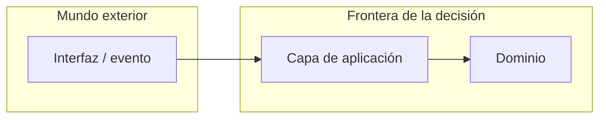

# ADR-000: [Título Corto de la Decisión Arquitectónica]

- **Estado**: Propuesto | Aceptado | Reemplazado por ADR-XXX
- **Fecha**: YYYY-MM-DD
- **Autor(es)**: [Nombre del Ingeniero / Equipo]
- **Reemplaza a**: (Opcional: ADR-XXX)

---

## 1. Contexto y Problema

Describe una sola decisión arquitectónica estructural y difícil de revertir, el contexto que la motiva y las restricciones vigentes. No dupliques requisitos funcionales de `spec.md` ni tareas de implementación.

---

## 2. Opciones Consideradas

1. **Opción A — [Nombre]**
   - Ventajas: ...
   - Desventajas: ...

2. **Opción B — [Nombre]**
   - Ventajas: ...
   - Desventajas: ...

---

## 3. Decisión Arquitectónica

Explica qué opción se seleccionó y por qué. Usa Mermaid únicamente para representar fronteras arquitectónicas, capas o topología de componentes.

---

## 4. Consecuencias y Trade-offs

- Positivas: ...
- Negativas / Trade-offs: ...
