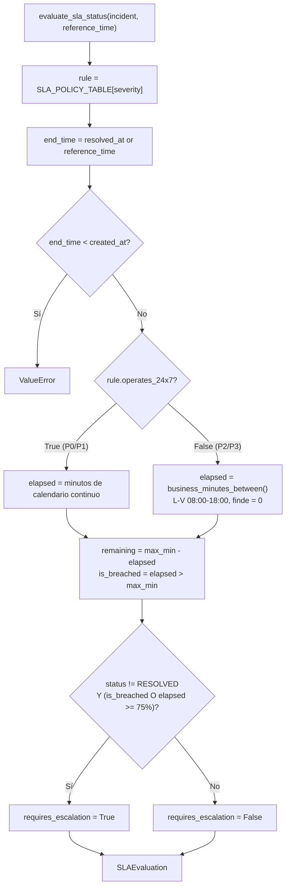
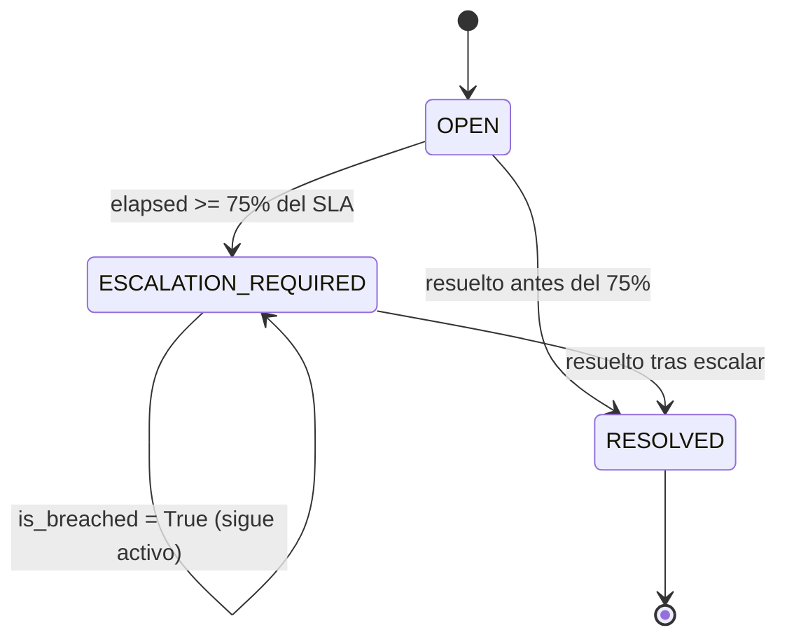

# ADR-002: Cálculo de SLA en Horario Hábil y Escalamiento Preventivo

- **Estado**: Aceptado
- **Fecha**: 2026-11-10
- **Autor(es)**: Equipo IncidentOps — Semana 1 (ISIA)
- **Componentes Afectados**: `src/sla_calculator.py`, `src/models.py`

---

## 1. Contexto y Problema

`evaluate_sla_status` calcula `elapsed_minutes` restando marcas de tiempo en calendario
continuo (24/7) para **todos** los incidentes. Según `SLA_POLICY_TABLE`, solo P0 y P1
(`operates_24x7=True`) corren 24/7. Los incidentes P2 y P3 (`operates_24x7=False`) deben
contabilizar únicamente **horario hábil: Lunes a Viernes de 08:00 a 18:00** (máximo 600
minutos hábiles por día; sábados y domingos no descuentan SLA).

El bug infla los minutos transcurridos de P2/P3: un ticket P2 creado el viernes 17:00 y
evaluado el lunes 09:00 cuenta ~64 horas de calendario cuando el SLA real es de 2 horas hábiles.

Casos borde que debe cubrir la solución:
- Ticket creado un viernes a las 18:30 (fuera de ventana) y evaluado el lunes 08:30.
- Ticket creado un sábado o que cruza uno o varios fines de semana.
- Escalamiento preventivo que **no** debe apagarse cuando el SLA ya se incumplió.

Restricciones: cero dependencias externas (solo `datetime` de la stdlib), determinismo y un
algoritmo legible de complejidad O(D), con D = días entre creación y evaluación.

---

## 2. Opciones Consideradas

1. **Opción A — Librería de calendario laboral externa (p. ej. `businesstimedelta`)**
   - *Ventajas*: maneja festivos y zonas horarias de fábrica.
   - *Desventajas*: añade dependencia pesada, rompe la restricción de cero dependencias y es
     innecesaria para la ventana fija L–V 08:00–18:00. **Descartada.**

2. **Opción B — Iterar minuto a minuto entre creación y evaluación**
   - *Ventajas*: trivial de escribir y de entender.
   - *Desventajas*: O(N) en minutos; un ticket P3 con SLA de 1440 min sobre varios días
     recorre decenas de miles de iteraciones. Ineficiente y frágil. **Descartada.**

3. **Opción C — Recorrer día por día e intersectar con la ventana hábil (O(D))** ✅
   - *Ventajas*: O(D) (pocas iteraciones), sin dependencias, legible, fácil de probar; separa
     con claridad la ruta 24/7 (P0/P1) de la ruta hábil (P2/P3).
   - *Desventajas*: no modela festivos (fuera de alcance de la Semana 1).

---

## 3. Decisión Arquitectónica

Se elige la **Opción C**. `evaluate_sla_status` enruta según `rule.operates_24x7`:

- **P0/P1 (24/7)**: `elapsed_minutes` = diferencia de calendario continuo.
- **P2/P3 (hábil)**: `elapsed_minutes` = `business_minutes_between(created_at, end_time)`,
  que recorre cada día del rango, descarta sábados y domingos (`weekday() >= 5`) e intersecta
  el intervalo con `[08:00, 18:00]`.

El **escalamiento preventivo** se activa (`requires_escalation=True`) cuando el incidente no
está `RESOLVED` **y** (`is_breached` es `True`) **o** (`elapsed_minutes >= 75%` del SLA). El
escalamiento ya no se apaga tras el incumplimiento.

---

## 4. Consecuencias e Impacto

- **Positivas**: los SLA de P2/P3 reflejan el compromiso real de negocio; se eliminan falsos
  incumplimientos por fines de semana; el escalamiento se mantiene activo tras el breach; cero
  dependencias nuevas; algoritmo O(D) y determinista.
- **Negativas / Trade-offs**: no contempla festivos ni múltiples zonas horarias (mejora futura,
  posible ADR-003); asume la ventana fija 08:00–18:00 en la zona horaria del servidor.
- **Verificación**: `uv run python -m src.sla_calculator` ejecuta 6 casos borde deterministas
  (viernes fuera de horario, creación en sábado, cruce de dos fines de semana, 24/7 vs. hábil,
  y un caso RESUELTO sin escalar) y todos deben imprimir `OK` / `TODOS LOS CASOS PASAN`.
