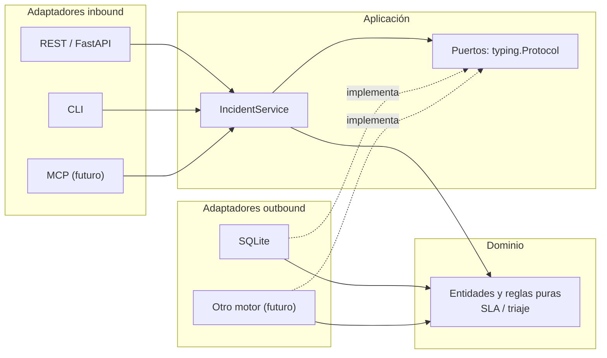

# ADR-003: Arquitectura Hexagonal para IncidentOps

- **Estado**: Aceptado
- **Fecha**: 2026-11-23
- **Autor(es)**: Equipo IncidentOps — Semana 1 (ISIA)
- **Reemplaza a**: No aplica

---

## 1. Contexto y Problema

`docs/ROADMAP.md` prevé que el mismo sistema sea consumido desde web y terminal (H001-H002), que mantenga ciclo de vida, duplicados y SLA (H003) y que migre hacia persistencia relacional dedicada con runtime en contenedores (H004). Hoy `src/models.py` concentra los tipos compartidos, `src/sla_calculator.py` y `src/triage_rules.py` contienen reglas deterministas, y `src/incident_repository.py` mezcla `sqlite3`, construcción de entidades y evaluación de SLA.

La decisión estructural es dónde queda la frontera entre reglas de negocio, casos de uso y mecanismos de entrega/persistencia. Definir esa frontera alrededor de FastAPI y SQLite haría que cada nuevo adaptador —REST, CLI o futuro MCP— y cada cambio de motor de base de datos obligue a repetir o reescribir lógica de dominio. La decisión es difícil de revertir porque afecta imports, paquetes y contratos entre capas.

Restricciones vigentes: las reglas de SLA y triaje deben seguir siendo deterministas y verificables sin servidor web ni base de datos real; el núcleo no debe depender de frameworks ni de motores de persistencia; se conserva el estilo en español y los comandos `python -m src...` como mecanismo de verificación.

---

## 2. Opciones Consideradas

1. **Opción A — Arquitectura en capas tradicional acoplada a FastAPI y SQLite**
   - Ventajas: estructura familiar, poco ceremonial y menos archivos; un solo router/servicio/repositorio por caso de uso; suficiente si el único consumidor previsto fuera REST sobre SQLite.
   - Desventajas: los modelos y servicios tienden a importar tipos de FastAPI y `sqlite3`; la CLI y un futuro MCP necesitarían controladores propios o adaptar el servicio a tipos HTTP; cambiar de motor de base de datos toca repositorio y servicios; las reglas de SLA y triaje quedan expuestas a serialización, errores HTTP y consultas N+1; probar el dominio exige framework o base de datos. **Descartada.**

2. **Opción B — Arquitectura Hexagonal con puertos y adaptadores** ✅
   - Ventajas: `src/domain/` contiene entidades y reglas puras; `src/application/` define puertos con `typing.Protocol` y expone `IncidentService`; `src/adapters/inbound/` aloja REST, CLI y futuro MCP; `src/adapters/outbound/` aloja SQLite y futuros motores. Una sola lógica de dominio sirve a todas las interfaces; añadir MCP o cambiar de base de datos no modifica el servicio; se pueden inyectar dobles en memoria para verificación.
   - Desventajas: más archivos e indirección; requiere mapear DTOs a entidades y viceversa; exige disciplina para que el dominio nunca importe adaptadores; la reubicación inicial de módulos y rutas tiene coste.

---

## 3. Decisión Arquitectónica

Se elige la **Opción B**. La frontera se define alrededor del dominio, no alrededor de un framework ni de un motor de datos. `IncidentService` es el único punto de orquestación de casos de uso; los puertos son `typing.Protocol` definidos en `src/application/`; los adaptadores inbound traducen REST, CLI y MCP a llamadas al servicio; los adaptadores outbound traducen esas llamadas a SQLite u otro motor. Las dependencias apuntan hacia adentro: los adaptadores conocen la aplicación y el dominio, nunca al revés.

Las flechas continuas representan dependencias de código; las discontinuas, implementación de un puerto. Ninguna flecha sale del dominio.

---

## 4. Consecuencias y Trade-offs

- Positivas: un único `IncidentService` para REST, CLI y MCP; dominio reutilizable sin FastAPI ni SQLite; cambiar de base de datos o añadir una interfaz no duplica reglas; SQL y el anti-patrón N+1 quedan confinados al adaptador outbound; la verificación determinista puede hacerse con dobles en memoria.
- Negativas / Trade-offs: más capas, más mapeos y más disciplina; sobrecarga inicial frente al script único actual; `src/context_audit.py` hoy solo hace glob de `src/*.py`, por lo que los nuevos subpaquetes quedarían fuera de la auditoría hasta ajustar su alcance; las rutas derivadas de `__file__` y los comandos `python -m src...` deben revisarse al reubicar módulos.
